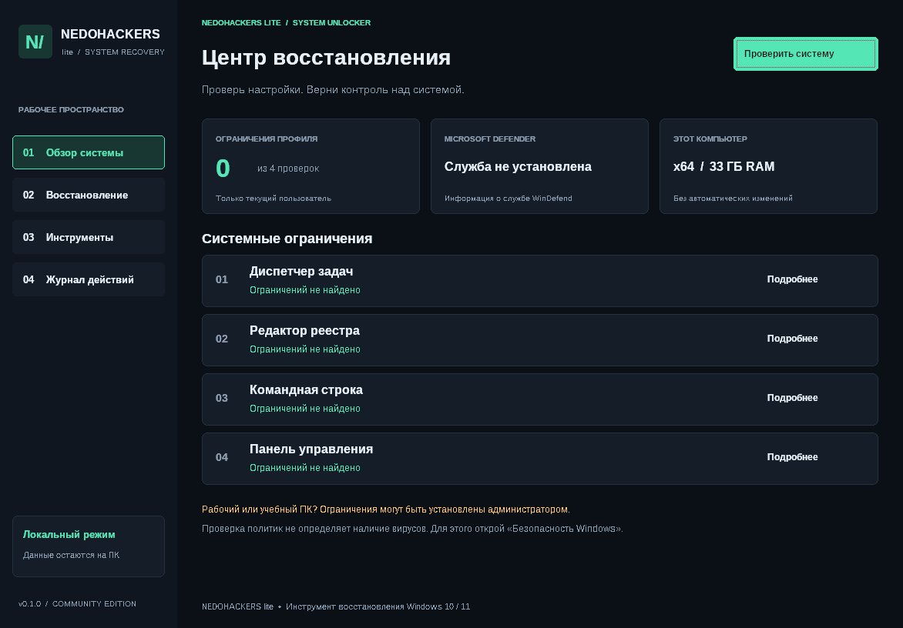

# NEDOHACKERS lite — System Recovery

Первая версия утилиты восстановления для **Windows 10/11 x64** на C++17 и Win32. Тёмный интерфейс, бирюзовые акценты, диагностика ограничений, резервные копии настроек и локальный журнал.



Снимок реального приложения под Wine 10. Сведения о системе на нём относятся к тестовой среде.

## Возможности

- Проверка пользовательских политик, ограничивающих диспетчер задач, редактор реестра, командную строку и панель управления.
- Восстановление выбранной настройки **после подтверждения**: сохранение исходного DWORD в UTF-16 `.reg`, повторная проверка значения, удаление только распознанного ограничения и проверка результата.
- Просмотр состояния службы Microsoft Defender. Это сведения о службе, а не результат антивирусной проверки.
- Открытие «Безопасности Windows», диспетчера задач, сведений о системе и параметров восстановления.
- Журнал текущего сеанса с копированием в буфер обмена.

Приложение проверяет только четыре значения **HKEY_CURRENT_USER**. Оно не определяет причину ограничения, не сканирует файлы на вирусы и не гарантирует восстановление запуска инструмента: существуют другие политики и причины неисправностей. Для проверки заражения используйте «Безопасность Windows» или установленный антивирус. На управляемом компьютере согласуйте изменения с администратором: групповая политика может восстановить ограничение.

## Скачать приложение

Готовые версии публикуются в разделе [Releases](https://github.com/Bezsmertny/SU---Added-by-Crimesql/releases).
В последнем выпуске откройте **Assets**, скачайте `NEDOHACKERS-lite-Windows-x64.zip`, распакуйте архив и запустите `NedohackersLite.exe`.

Если выпуск ещё собирается, состояние видно во вкладке [Actions](https://github.com/Bezsmertny/SU---Added-by-Crimesql/actions). Выпуск создаётся только после успешной сборки и тестов. Для обычных запусков CI ZIP доступен среди артефактов завершённого запуска; загрузка артефактов требует входа в GitHub.

## Сборка и запуск на Windows

Нужны Visual Studio 2022 / Build Tools с компонентом **Desktop development with C++**, Windows SDK и CMake 3.20+.

```powershell
cmake -S . -B build -A x64
cmake --build build --config Release --parallel 2
ctest --test-dir build -C Release --output-on-failure
.\build\Release\NedohackersLite.exe
```

Дополнительные GUI-библиотеки не нужны. Приложение работает с правами текущего пользователя. Системные средства могут отдельно запросить повышение прав. MSVC-сборка использует статическую среду выполнения C++.

Нажмите **«Проверить систему»**, изучите найденные ограничения и при необходимости выберите **«Восстановить»** у конкретной настройки. Автоматических изменений при запуске или диагностике нет. Tab / Shift+Tab переключают кнопки, Space активирует выбранную кнопку.

## Резервные копии

Копии создаются перед изменением в `%LOCALAPPDATA%\NEDOHACKERS lite\Backups`. Если копию сохранить не удалось, настройка не изменяется. Путь к каждой копии записывается в журнал.

Чтобы вернуть прежнее значение, проверьте содержимое нужного `.reg` и импортируйте его через редактор реестра **в той же учётной записи**. Это вернёт исходное ограничение. Резервная копия содержит только выбранное значение, а не весь реестр. Время, имя пользователя в пути и настройки могут быть видны в скопированном журнале; проверьте его перед публикацией.

## Тесты и ограничения проверки

```sh
# На Linux проверяется переносимая логика, а не GUI Windows.
cmake -S . -B build
cmake --build build --parallel 2
ctest --test-dir build --output-on-failure
```

`recovery_tests` проверяет распознавание ограничений, неизвестных типов/значений, ошибок доступа и точное содержимое `.reg`. На Windows дополнительно запускается `windows_integration_tests`: он создаёт отдельный временный ключ в HKCU, проверяет восстановление, резервную копию, отказ при изменившемся значении и удаляет свои данные. Реальные системные политики тест не меняет.

GitHub Actions настроен на сборку Windows x64, оба набора тестов и сохранение ZIP в артефактах запуска. При отправке тега `v*` после успешных тестов создаётся GitHub Release с ZIP. Для публикации используется встроенный `GITHUB_TOKEN` с правом `contents: write` только в задании выпуска; отдельные токены не нужны. В Linux можно собрать Windows `.exe` через MinGW-w64, но проверять интерфейс, работу системных инструментов и реальные политики нужно на Windows 10/11, предпочтительно в тестовой виртуальной машине.

## Структура

- `src/main.cpp` — интерфейс Win32/GDI, навигация и подтверждения.
- `src/recovery.*` — правила диагностики и формат резервной копии.
- `src/windows_system.*` — реестр, файлы копий, службы и системные инструменты.
- `resources/` — манифест DPI и сведения о версии.
- `tests/` — переносимые и интеграционные проверки.
